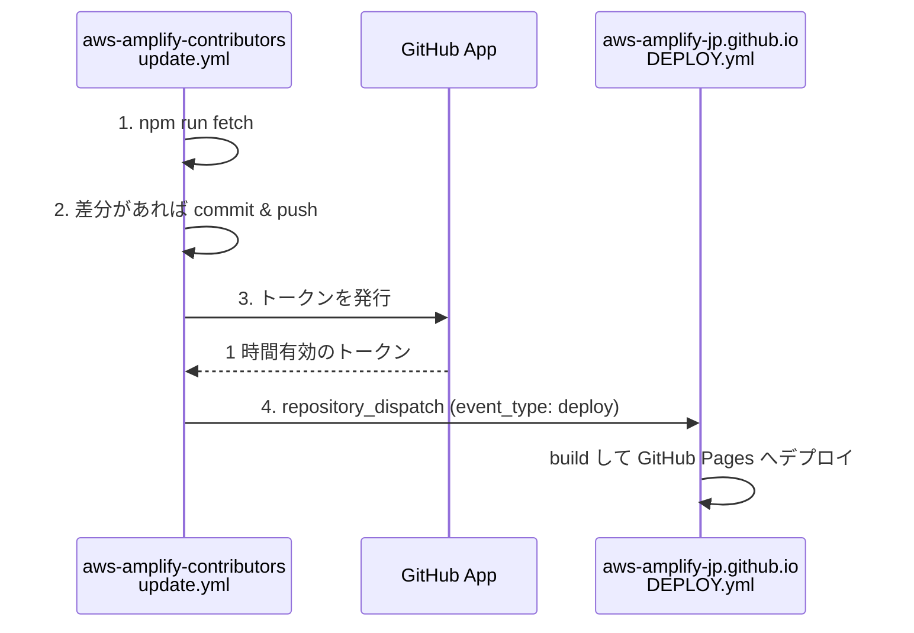

# サイトのデプロイ起動に使う GitHub App

このリポジトリの `update` ワークフロー（`.github/workflows/update.yml`）は、コントリビューターのリストに変更があったとき、
[aws-amplify-jp/aws-amplify-jp.github.io](https://github.com/aws-amplify-jp/aws-amplify-jp.github.io) のデプロイを起動します。
そのための認証に GitHub App を使っています。このドキュメントでは、仕組みと設定、作り直すときの手順をまとめます。

## 全体の流れ

- 手順 3 は [`actions/create-github-app-token`](https://github.com/actions/create-github-app-token) で行います。
- 手順 4 は `src/dispatchDeploy.mjs` が `POST /repos/aws-amplify-jp/aws-amplify-jp.github.io/dispatches` を呼びます。
- 手順 3 と 4 は、手順 2 で差分があったときだけ実行されます。

## GitHub App を使う理由

別のリポジトリに `repository_dispatch` を送るには、そのリポジトリへの書き込み権限を持つトークンが必要です。
ワークフローが標準で受け取る `GITHUB_TOKEN` は実行中のリポジトリでしか使えないため、この用途には使えません。

以前は個人アカウントの PAT（classic）を Secret に登録していましたが、次の問題があったため GitHub App に切り替えました。

- PAT は発行した人のアカウントに結びつくので、その人が org を抜けると動かなくなる
- classic PAT は権限の範囲が広く、対象リポジトリも絞れない
- 有効期限ごとに更新し直す必要がある

GitHub App のトークンはワークフローの実行ごとに発行され、1 時間で失効します。
権限は App に与えた範囲（下記）に限られます。

## 設定内容

### GitHub App

| 項目 | 設定値 |
|---|---|
| 所有者 | aws-amplify-jp org |
| Webhook | 無効（Active のチェックを外す） |
| Repository permissions | **Contents: Read and write** のみ（`repository_dispatch` の API に必要） |
| インストールできるアカウント | Only on this account |
| インストール先 | aws-amplify-jp org の **`aws-amplify-jp.github.io` のみ**（Only select repositories） |

App の設定画面は org の Settings → Developer settings → GitHub Apps にあります。

### このリポジトリに登録する値

Settings → Secrets and variables → Actions に登録します。

| 種類 | 名前 | 中身 |
|---|---|---|
| Variable | `DEPLOY_APP_CLIENT_ID` | App の Client ID（App 設定画面の About に表示される） |
| Secret | `DEPLOY_APP_PRIVATE_KEY` | App の秘密鍵（`.pem` ファイルの中身をそのまま貼る） |

Client ID は秘密情報ではないので Variable にしています。秘密鍵は必ず Secret に登録し、リポジトリにはコミットしないでください。

> `actions/create-github-app-token` は v3.1.0 から `app-id` 入力が非推奨になったため、App ID ではなく Client ID を使っています。

## 運用

### 秘密鍵を入れ替える

1. App の設定画面で「Generate a private key」を押し、新しい `.pem` をダウンロードする
2. このリポジトリの Secret `DEPLOY_APP_PRIVATE_KEY` を新しい鍵の中身で上書きする
3. ワークフローを手動か push で実行し、デプロイが起動することを確認する
4. App の設定画面で古い鍵を削除する
5. ダウンロードした `.pem` をローカルから削除する

### App を作り直す

「設定内容」の表のとおりに App を作り、インストールしたあと、Variable と Secret を登録し直してください。

### 動かないとき

`update` ワークフローの「Generate token」か「Dispatch Deploy」のステップが失敗している場合は、次の点を確認してください。

- Variable `DEPLOY_APP_CLIENT_ID` と Secret `DEPLOY_APP_PRIVATE_KEY` が登録されているか
- App が `aws-amplify-jp.github.io` にインストールされているか
- App の権限に Contents: Read and write があるか（権限を変えた場合、org 側でインストールの承認が必要なことがある）
- 秘密鍵が App の設定画面で削除されていないか

dispatch は成功しているのにデプロイされない場合は、`aws-amplify-jp.github.io` 側の `DEPLOY.yml` に
`repository_dispatch`（`types: [deploy]`）のトリガーが残っているかを確認してください。
